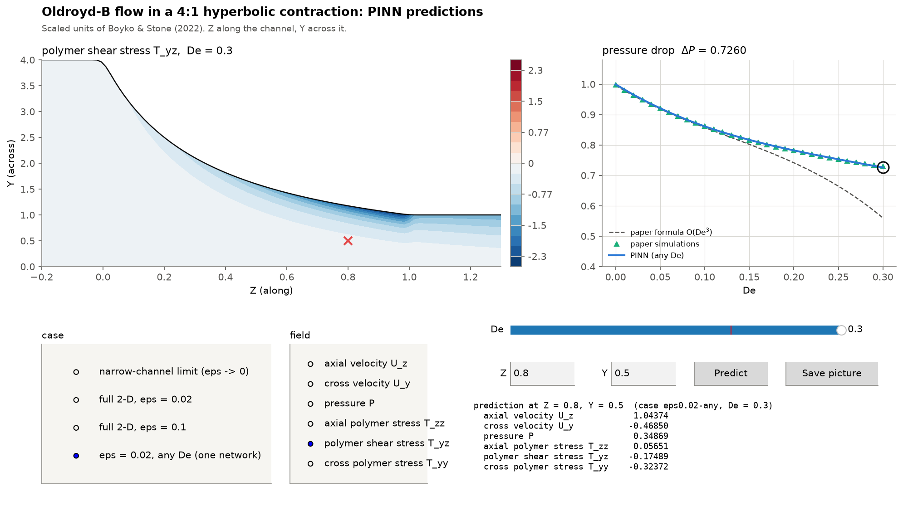

# Oldroyd-B flow in a narrowing channel, solved with a physics-informed neural network

CLL731 (Advanced Transport Phenomena) term paper · Rahul Arvind Masand (2022CH71476) · IIT Delhi · November 2026

We re-solve the problem of **Boyko & Stone (2022), *J. Fluid Mech.* 936, A23**: a polymer solution (Oldroyd-B fluid) is pushed through a narrow 2-D channel that contracts 4:1, and we want the pressure drop. We solve it with a **physics-informed neural network (PINN)** trained only on the flow equations, and check it against the paper's formulas, the paper's own simulations and an independent numerical solver we wrote.

**Submission summary (2 pages):** [`06_submission/CLL731_term_paper_summary.pdf`](06_submission/CLL731_term_paper_summary.pdf)

---

## 1. Just read the results (nothing to install)

* Open [`05_notebook/CLL731_OldroydB_PINN.ipynb`](05_notebook/CLL731_OldroydB_PINN.ipynb) here on GitHub: it shows the full report, code and charts.
* Or download [`05_notebook/CLL731_OldroydB_PINN.html`](05_notebook/CLL731_OldroydB_PINN.html) and open it in any browser.

## 2. Run it on your own computer (one command)

You need **Python 3.10–3.13** ([python.org](https://www.python.org/downloads/); on Windows tick *"Add python.exe to PATH"*). No GPU is needed.

**Windows** (Command Prompt or PowerShell):

```bat
git clone https://github.com/RM1102/CLL731-OldroydB-PINN.git
cd CLL731-OldroydB-PINN
setup_and_run.bat
```

**macOS / Linux** (Terminal):

```bash
git clone https://github.com/RM1102/CLL731-OldroydB-PINN.git
cd CLL731-OldroydB-PINN
bash setup_and_run.sh
```

No `git`? Click **Code → Download ZIP** on this page, unzip it, and double-click `setup_and_run.bat` (Windows) or `setup_and_run_mac.command` (Mac).

The script creates a private Python environment inside the folder (`.venv`; nothing is installed system-wide), installs the packages, and then offers a menu:

| Option | What it does | Time |
|---|---|---|
| 1 | open the **PINN explorer window** | seconds |
| 2 | open the **notebook** (full report; runs in about 20 s with the saved networks) | seconds |
| 3 | **quick check** that everything works | ~10 s |
| 4 | **retrain** every network from scratch | **about 4 hours** |

> **Time warnings.** The first setup downloads about 1 GB (PyTorch and Jupyter) and takes 5–15 minutes. Retraining (option 4) takes about 4 hours on a laptop CPU and is **not needed**: all 16 trained networks are included in `04_results/pinn/`.

## 3. Use the trained PINN for predictions

A trained PINN is a formula. Give it a position and a Deborah number, and it returns the velocity, pressure and polymer stress there in a fraction of a second. Nothing is solved again.

**The explorer window** (`setup_and_run` option 1, or `python gui.py`): choose a case and a field, move the De slider, and type a point (Z, Y) to read every predicted value there.



**The command line** (`python predict.py`, inside the environment: `.venv\Scripts\python` on Windows, `.venv/bin/python` on Mac):

```bash
python predict.py --list                                    # cases and trained De values
python predict.py --case eps0.02 --De 0.2 --dp              # pressure drop (also in pascals)
python predict.py --case eps0.02 --De 0.2 --point 0.5 0.3   # every field at Z = 0.5, Y = 0.3
python predict.py --case eps0.02-any --De 0.17 --dp         # any De from 0 to 0.3, one network
python predict.py --case eps0 --De 0.1 --csv fields.csv     # whole field to a CSV file
```

Cases: `eps0` (narrow-channel limit), `eps0.02` and `eps0.1` (full 2-D, the paper's two channels), `eps0.02-any` (one network covering every De). Inputs and outputs are in the paper's scaled units: Z = z/ℓ along the channel (0 to 1 across the contraction), Y = y/h_ℓ across it (0 on the centreline). The networks are trained for α = 4, β̃ = 0.4 and 0 ≤ De ≤ 0.3; outside that range they are not reliable.

## 4. Main results

All numbers come from [`04_results/summary.md`](04_results/summary.md), generated from the saved results. ΔP is the centreline pressure drop across the contraction.

| Check | Result |
|---|---|
| Paper's formulas, re-derived with SymPy | all confirmed; one sign typo found in arXiv eq. (3.16b) |
| Our reference solver vs the paper's simulations (ε = 0.02, De 0–0.3) | within 0.37 % |
| PINN vs reference solver, narrow-channel limit, De 0–0.3 | within 0.22 % |
| PINN vs the paper's simulations, full 2-D, ε = 0.02 and 0.1 | within 0.68 % (1.05 % by a second route) |
| Paper's 3rd-order formula vs the simulations at De = 0.3 | 23–26 % too low |
| PINN stress fields vs reference solver | 0.01–0.5 % over most of the channel; a few percent at the two corners |
| Why elasticity lowers ΔP | the polymer shear-stress gradient, as the paper says |

## 5. What is in each folder

| Folder | Contents |
|---|---|
| `01_research/` | paper notes in plain words, literature review (56 references), code survey (44 tools), link to the paper |
| `02_plan/` | approach, design decisions, and a log of every change made while building |
| `03_code/oldroydb/` | the Python package: geometry, paper formulas, reference solver, PINN, prediction, plotting |
| `03_code/scripts/` | reproducible scripts: formula checks, data recovery from the paper, training, summaries |
| `03_code/tests/` | quick checks (`python -m pytest -q 03_code/tests`) |
| `04_results/` | trained networks, reference solutions, recovered paper data, figures, `summary.md` |
| `05_notebook/` | the main report: notebook and HTML copy |
| `06_submission/` | the 2-page submission summary |
| `gui.py`, `predict.py` | the explorer window and the command-line predictor |

Re-running the research steps (from `03_code/scripts/`): `derive_perturbation_sympy.py` (5 s), `newtonian_eps2_correction.py` (5 s), `digitize_fe_data.py` (2 s; needs the paper PDF, see `01_research/papers/`), `run_reference_solver.py` (3 min), `run_campaign.py --chain all` (about 4 h), `finalize_deliverables.py` (2 min; rebuilds the summary, notebook, HTML, figures and zip).

---

*Use of AI: the literature search, code and text of this project were developed with the help of an AI assistant (Claude), as stated in the project proposal. All results were checked against the paper and an independent solver.*
